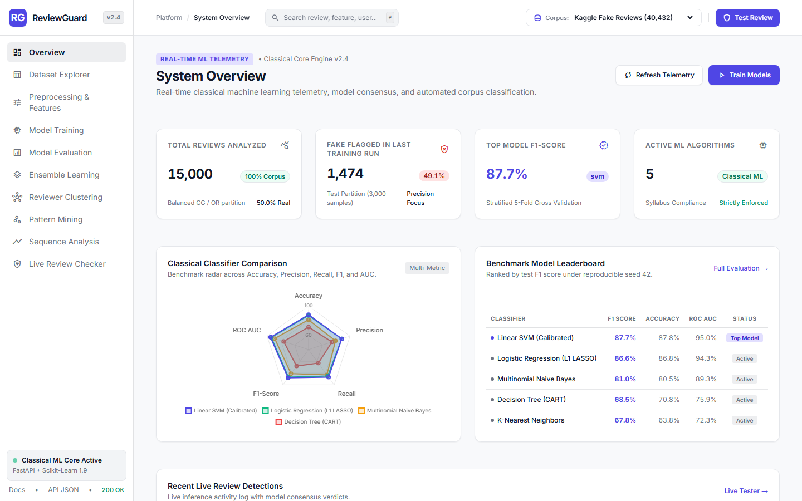
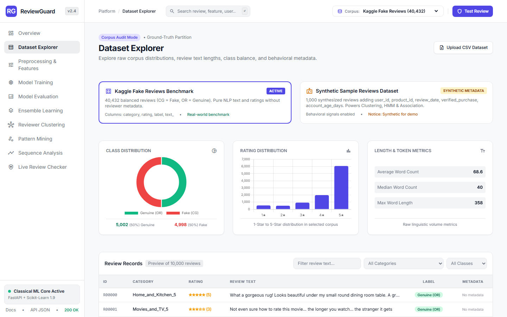
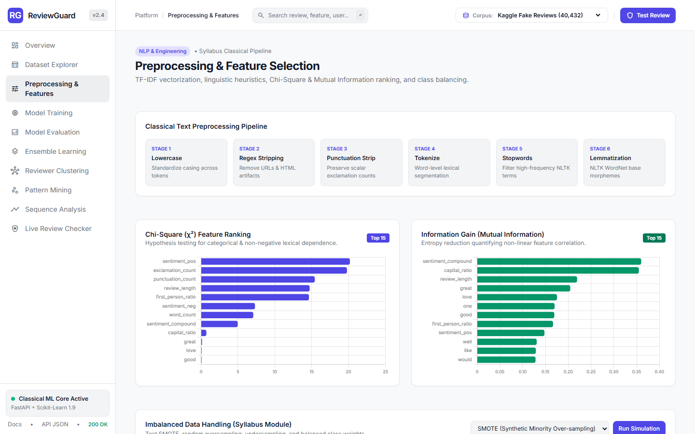
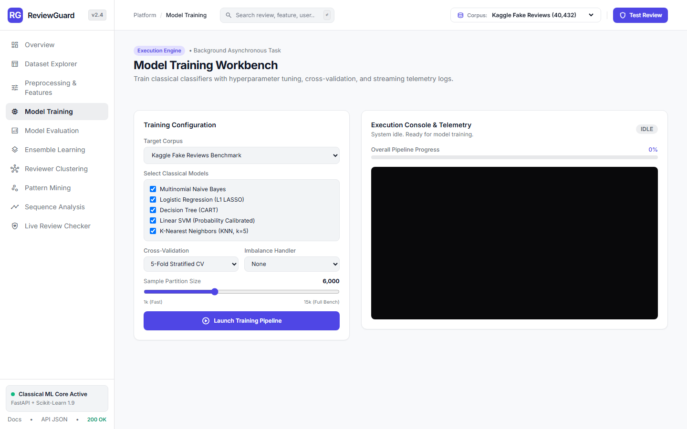
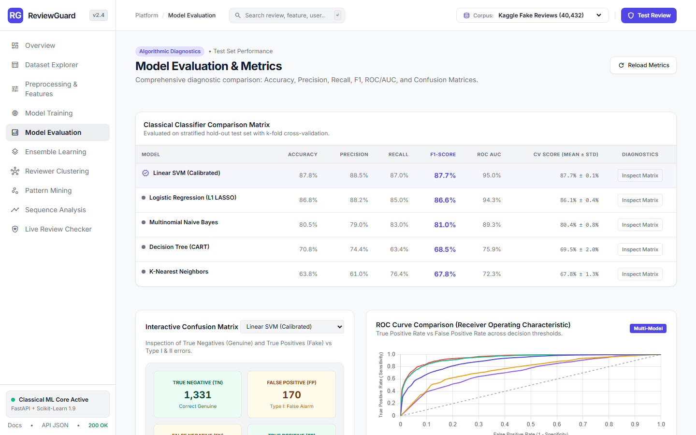
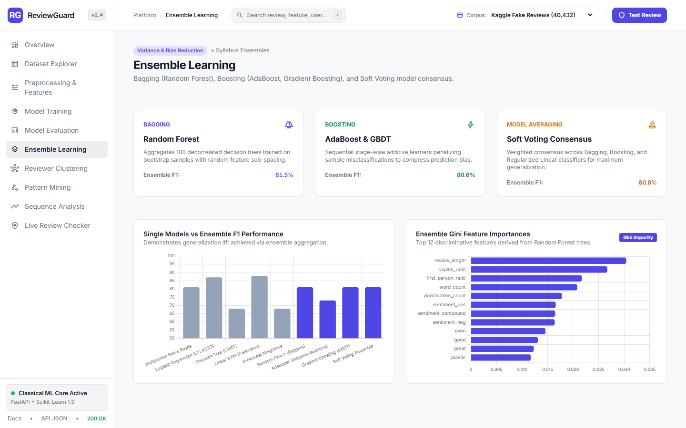
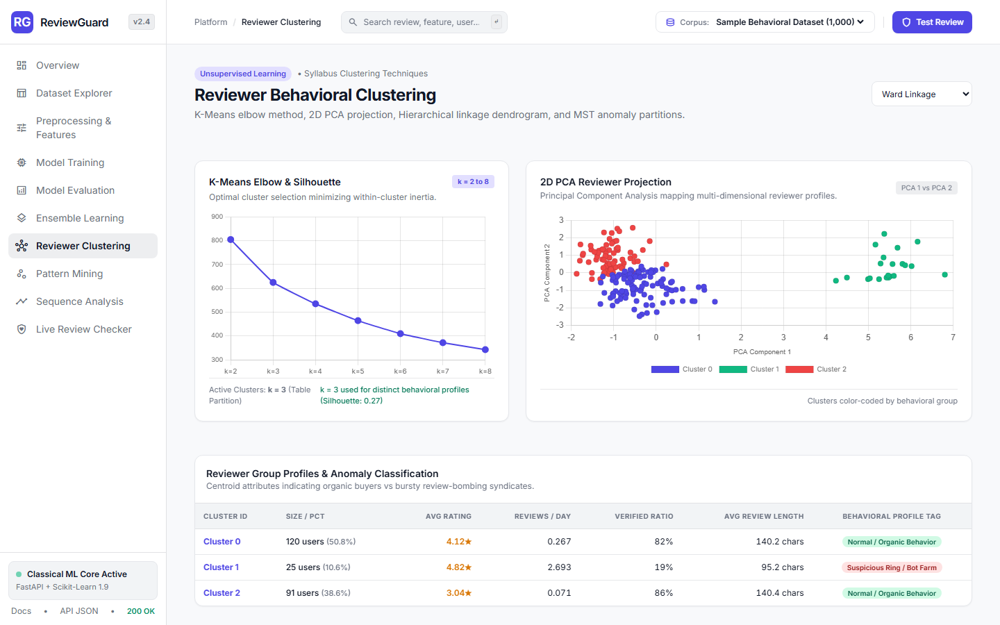
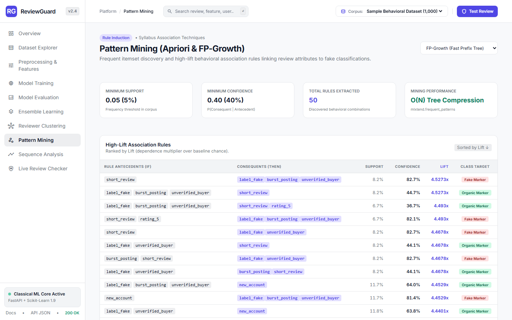
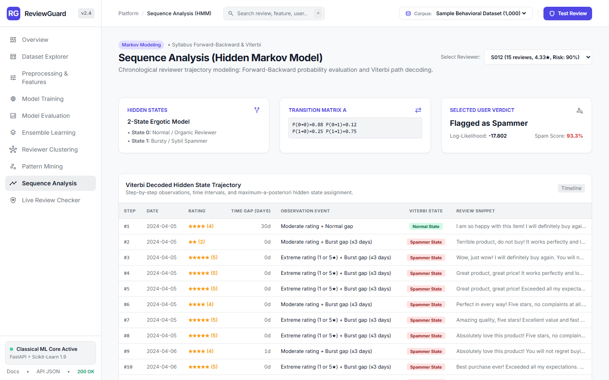
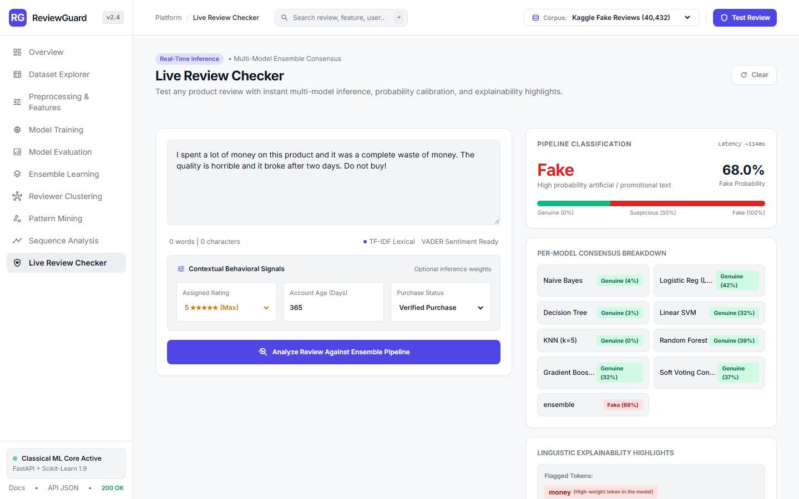

# ReviewGuard

> Classical Machine Learning Platform for Fake Product Review Detection and Reviewer Behavioral Auditing



---

## About the Project

**ReviewGuard** is an end-to-end fake product review detection and behavioral analysis platform developed as a **B.Tech Computer Science & Engineering (Artificial Intelligence & Machine Learning)** project.

The system relies strictly on **classical machine learning algorithms**, statistical NLP feature engineering, unsupervised clustering, association rule mining, and discrete Markov sequence modeling. It intentionally avoids deep neural networks and transformer architectures to highlight the power, diagnostic transparency, low computational overhead, and microsecond inference latencies of classical algorithms in high-dimensional text classification.

ReviewGuard addresses two core fraud dimensions:
1. **Linguistic Deception:** Distinguishing authentic customer sentiments from computer-generated or incentivized text using lexical patterns and linear decision boundaries.
2. **Reviewer Behavioral Anomalies:** Uncovering organized reviewer syndicates, unusual rating velocity, and deceptive posting transitions using unsupervised and sequential techniques.

---

## Key Features

ReviewGuard is organized into 10 interactive dashboard modules:

| # | Page | Core Capability |
| :--- | :--- | :--- |
| **01** | **System Overview** | High-level intelligence telemetry, active model count, radar performance comparison, and real-time detection logs. |
| **02** | **Dataset Explorer** | Filterable records table with class balance indicators and star rating histograms across the 40,432-record benchmark. |
| **03** | **Preprocessing & Features** | Text normalization, TF-IDF n-gram extraction, statistical text metrics, and interactive SMOTE / under-sampling simulation. |
| **04** | **Model Training & Tuning** | Asynchronous training runner across 5 classical classifiers with hyperparameter inspection and stratified splitting. |
| **05** | **Model Evaluation & Diagnostics** | Diagnostic leaderboard, confusion matrices, ROC curves, Precision-Recall curves, and 5-fold cross-validation spreads. |
| **06** | **Ensemble Learning** | Multi-estimator evaluation featuring Random Forest bagging, AdaBoost, Gradient Boosting (GBDT), and Soft Voting consensus. |
| **07** | **Reviewer Clustering** | Unsupervised behavioral grouping via K-Means (Elbow & Silhouette), 2D PCA projection, Agglomerative dendrograms, and MST graphs. |
| **08** | **Pattern Mining** | Co-purchasing and frequent itemset discovery using Apriori and FP-Growth with Support, Confidence, and Lift metrics. |
| **09** | **Sequence Analysis** | First-order Markov chain transition matrices and Hidden Markov Models (HMM) tracking deceptive reviewer state shifts. |
| **10** | **Live Review Checker** | Interactive inference console outputting calibrated probabilities, per-model votes, and token-level explainability highlights. |

---

## Screenshot Gallery

<details>
<summary><b>Click to expand full UI screenshot gallery (10 pages)</b></summary>

<br>

### 01. System Overview


### 02. Dataset Explorer


### 03. Preprocessing & Feature Extraction


### 04. Model Training & Tuning


### 05. Model Evaluation & Diagnostics


### 06. Ensemble Learning


### 07. Reviewer Clustering


### 08. Pattern Mining


### 09. Sequence Analysis


### 10. Live Review Checker


</details>

---

## Academic Syllabus Coverage

This platform maps comprehensive B.Tech CSE (AIML) coursework into functional software components:

| Module | Core Topic | Implementation File(s) | Dashboard Page |
| :--- | :--- | :--- | :--- |
| **Data Acquisition & NLP** | Text normalization, tokenization, lemmatization, stopword removal | `reviewguard/src/preprocess.py`<br>`reviewguard/src/load_data.py` | `02-dataset-explorer`<br>`03-preprocessing-and-features` |
| **Feature Engineering** | TF-IDF n-grams (1, 2), lexical length, exclamation density, sentiment polarity | `reviewguard/src/features.py` | `03-preprocessing-and-features` |
| **Feature Selection** | Chi-Square ($\chi^2$) ranking, Mutual Information scoring | `reviewguard/src/feature_selection.py` | `03-preprocessing-and-features` |
| **Class Imbalance** | SMOTE oversampling, Random Under-sampling (RUS), cost-sensitive class weights | `reviewguard/src/imbalance.py` | `03-preprocessing-and-features` |
| **Supervised Learning** | Multinomial Naive Bayes, KNN, CART Decision Tree, Logistic Regression, Linear SVM | `reviewguard/src/train.py` | `04-model-training`<br>`05-model-evaluation` |
| **Model Validation** | Confusion matrices, Precision, Recall, F1, ROC-AUC, 5-Fold Stratified CV | `reviewguard/src/evaluate.py` | `05-model-evaluation` |
| **Ensemble Methods** | Random Forest (Bagging), AdaBoost, Gradient Boosting, Soft Voting consensus | `reviewguard/src/ensemble.py` | `06-ensemble-learning` |
| **Unsupervised Clustering** | K-Means, Elbow curve, Silhouette analysis, 2D PCA, Hierarchical Linkage, MST | `reviewguard/src/clustering.py` | `07-reviewer-clustering` |
| **Association Rules** | Apriori algorithm, FP-Growth, Support, Confidence, Lift | `reviewguard/src/association.py` | `08-pattern-mining` |
| **Sequential Modeling** | First-order Markov chain, Hidden Markov Model (HMM) transitions | `reviewguard/src/hmm_model.py` | `09-sequence-analysis` |
| **Explainable AI & Deployment** | Feature weight attribution, token highlight explainability, REST API | `reviewguard/src/predict.py`<br>`reviewguard/app/routes/predict.py` | `10-live-review-checker` |

---

## Tech Stack

| Layer | Component | Version | Role in ReviewGuard |
| :--- | :--- | :--- | :--- |
| **Backend API** | FastAPI | `>=0.110.0` | Asynchronous REST backend providing endpoints for all 10 pages |
| **ASGI Server** | Uvicorn | `>=0.28.0` | High-performance asynchronous web server |
| **Core ML** | Scikit-learn | `>=1.4.0` | Classifiers, TF-IDF vectorizer, PCA, K-Means, cross-validation |
| **Scientific Computing** | NumPy & SciPy | `>=1.26.0`, `>=1.12.0` | Matrix mathematics, sparse array handling, hierarchical linkage, MST |
| **Data Manipulation** | Pandas | `>=2.2.0` | Tabular data ingestion, aggregation, and reviewer profiling |
| **NLP Utilities** | NLTK | `>=3.8.1` | Stopwords, WordNet lemmatizer, VADER sentiment analyzer |
| **Pattern Mining** | MLxtend | `>=0.23.0` | Apriori and FP-Growth frequent itemset extraction |
| **Sampling & Balancing** | Imbalanced-learn | `>=0.12.0` | SMOTE and RandomUnderSampler implementations |
| **Model Persistence** | Joblib | `>=1.3.0` | Serialized estimator pipelines and trained feature weights |
| **Test Framework** | Pytest | `>=8.0.0` | Automated test suite validating data pipelines, API routes, and models |
| **Frontend UI** | HTML5 / Tailwind CSS / Vanilla JS | — | Responsive client interface with Chart.js visualizations |

---

## Project Structure

```text
Review Guard/
├── docs/
│   └── screenshots/               # Clean UI captures (01-overview.png through 10-live-review-checker.png)
├── reviewguard/
│   ├── app/
│   │   ├── routes/                # FastAPI endpoint handlers
│   │   │   ├── association.py     # Apriori & association rule endpoints
│   │   │   ├── clustering.py      # K-Means, PCA, and dendrogram endpoints
│   │   │   ├── datasets.py        # Dataset preview and exploration endpoints
│   │   │   ├── ensemble.py        # Ensemble comparison endpoints
│   │   │   ├── evaluation.py      # Detailed metrics and curve endpoints
│   │   │   ├── features.py        # Feature importance and imbalance endpoints
│   │   │   ├── hmm.py             # Markov and HMM sequence endpoints
│   │   │   ├── overview.py        # High-level telemetry and status endpoints
│   │   │   ├── predict.py         # Real-time live inference endpoints
│   │   │   └── train.py           # Background training execution endpoints
│   │   ├── main.py                # FastAPI application entry point and static mount
│   │   └── schemas.py             # Pydantic request and response schemas
│   ├── data/                      # Local dataset storage directory
│   ├── frontend/
│   │   ├── app.js                 # Frontend application logic, routing, and Chart.js binding
│   │   └── index.html             # Single-page application dashboard layout
│   ├── models/                    # Serialized joblib models and metrics JSON caches
│   ├── src/                       # Classical ML algorithms and data processing core
│   │   ├── association.py         # Apriori and FP-Growth pattern mining
│   │   ├── clustering.py          # K-Means, PCA, Hierarchical clustering, and MST
│   │   ├── ensemble.py            # Random Forest, AdaBoost, GBDT, and Soft Voting
│   │   ├── evaluate.py            # Metrics calculation, ROC/PR curves, and 5-fold CV
│   │   ├── feature_selection.py   # Chi-Square and Mutual Information selection
│   │   ├── features.py            # TF-IDF and statistical linguistic feature extraction
│   │   ├── hmm_model.py           # First-order Markov chain and HMM modeling
│   │   ├── imbalance.py           # SMOTE, random under-sampling, and class weighting
│   │   ├── load_data.py           # Dataset loaders and metadata validation
│   │   ├── predict.py             # Inference engine with token explainability
│   │   ├── preprocess.py          # Text cleaning, regex stripping, and lemmatization
│   │   └── train.py               # Supervised model training orchestration
│   └── tests/                     # Pytest test suite covering core modules
│       ├── test_api.py            # FastAPI endpoint tests
│       ├── test_clustering_association_hmm.py  # Unsupervised algorithms tests
│       ├── test_features.py       # Linguistic feature extraction tests
│       ├── test_loader.py         # Dataset loader tests
│       ├── test_models.py         # Training and evaluation tests
│       ├── test_predict.py        # Live predictor tests
│       └── test_preprocess.py     # NLP preprocessing tests
├── .gitignore                     # Git ignore rules for environments and large data
├── fake reviews dataset.csv       # Kaggle 40,432 benchmark dataset (local only)
├── requirements.txt               # Locked production dependencies
├── run.bat                        # Windows launch batch script
├── run.sh                         # Unix launch shell script
└── sample_reviews_dataset.csv     # 1,000-row synthetic dataset with behavioral metadata
```

---

## Setup & Execution

### 1. Environment Setup

#### Windows (PowerShell)
```powershell
python -m venv venv
.\venv\Scripts\Activate.ps1
```

#### macOS / Linux
```bash
python3 -m venv venv
source venv/bin/activate
```

### 2. Dependency Installation
```bash
pip install -r requirements.txt
```

### 3. NLTK Lexicon & Corpora Downloads
```bash
python -c "import nltk; nltk.download('stopwords'); nltk.download('wordnet'); nltk.download('omw-1.4')"
```

### 4. Dataset Placement
Ensure both datasets are located in the repository root (or inside `reviewguard/data/`):
- `fake reviews dataset.csv` (Kaggle 40,432 reviews benchmark)
- `sample_reviews_dataset.csv` (1,000-row behavioral dataset)

### 5. Model Training (Optional - pre-computed artifacts are included in models/)
```bash
python -m reviewguard.src.train
```

### 6. Running the Application
Launch the server with the following command:
```bash
python -m uvicorn reviewguard.app.main:app --host 0.0.0.0 --port 8000
```
Open your browser and navigate to:
```text
http://127.0.0.1:8000
```

### 7. Running the Automated Test Suite
```bash
python -m pytest
```

---

## API Endpoints

All application routes are documented interactively via OpenAPI at `http://127.0.0.1:8000/docs`.

| Method | Endpoint | File Route | Purpose |
| :--- | :--- | :--- | :--- |
| `GET` | `/api/health` | `app/main.py` | Service health status check |
| `GET` | `/api/overview` | `app/routes/overview.py` | Dashboard telemetry, top metrics, radar stats, recent predictions |
| `GET` | `/api/datasets` | `app/routes/datasets.py` | Available datasets and schema attributes |
| `POST` | `/api/dataset/upload` | `app/routes/datasets.py` | Upload custom CSV dataset for analysis |
| `GET` | `/api/dataset/explore` | `app/routes/datasets.py` | Paginated review records, category filters, and label distribution |
| `GET` | `/api/features/importance` | `app/routes/features.py` | Top positive and negative TF-IDF feature coefficients |
| `POST` | `/api/imbalance` | `app/routes/features.py` | Simulate SMOTE, Under-sampling, or Class Weighting |
| `POST` | `/api/train` | `app/routes/train.py` | Launch background retraining across classical models |
| `GET` | `/api/train/status` | `app/routes/train.py` | Retraining progress and execution log state |
| `GET` | `/api/evaluation` | `app/routes/evaluation.py` | Diagnostic metrics, confusion matrices, ROC/PR curves, 5-fold CV |
| `GET` | `/api/ensemble` | `app/routes/ensemble.py` | Comparative metrics across ensemble architectures |
| `GET` | `/api/clustering` | `app/routes/clustering.py` | K-Means elbow data, 2D PCA scatter, dendrogram, and MST edges |
| `GET` | `/api/association` | `app/routes/association.py` | Apriori & FP-Growth frequent itemsets and association rules |
| `GET` | `/api/hmm/summary` | `app/routes/hmm.py` | Markov chain transition matrix, emission matrix, stationary states |
| `GET` | `/api/hmm/{user_id}` | `app/routes/hmm.py` | User-specific sequence transitions and anomaly probability |
| `POST` | `/api/predict` | `app/routes/predict.py` | Real-time review classification with explainability highlights |
| `GET` | `/api/history` | `app/routes/predict.py` | Audit log of recent predictions |

---

## Experimental Results

All models were evaluated on the test partition ($N = 3,000$ stratified samples from a 15,000-review dataset split 80/20 with random state 42). Features consist of 2,000 TF-IDF n-grams (unigrams and bigrams) combined with 9 statistical linguistic attributes.

### Classical Single Models

| Model | Test Accuracy | Precision | Recall | F1-Score | ROC-AUC |
| :--- | :---: | :---: | :---: | :---: | :---: |
| **Linear SVM (Calibrated)** | **87.83%** | **88.47%** | **86.99%** | **87.72%** | **0.9501** |
| **Logistic Regression (L2 / Balanced)** | 86.83% | 88.23% | 84.99% | 86.58% | 0.9428 |
| **Multinomial Naive Bayes** | 80.50% | 79.03% | 82.99% | 80.96% | 0.8929 |
| **CART Decision Tree** | 70.80% | 74.35% | 63.44% | 68.47% | 0.7595 |
| **K-Nearest Neighbors ($k=5$)** | 63.77% | 60.96% | 76.45% | 67.83% | 0.7233 |

### Ensemble Models

| Ensemble Architecture | Aggregation Strategy | Test Accuracy | Precision | Recall | F1-Score | ROC-AUC |
| :--- | :--- | :---: | :---: | :---: | :---: | :---: |
| **Random Forest** | Bootstrap Bagging (100 Trees) | 81.92% | 83.54% | 79.50% | 81.47% | 0.9169 |
| **Soft Voting Consensus** | Weighted Probability Mixture | 81.33% | 82.98% | 78.83% | 80.85% | 0.9120 |
| **Gradient Boosting (GBDT)** | Stage-wise Boosting | 80.92% | 82.04% | 79.17% | 80.58% | 0.9048 |
| **AdaBoost** | Exponential Loss Reweighting | 73.25% | 73.21% | 73.33% | 73.27% | 0.7995 |

### Empirical Analysis: Why Ensembles Did Not Beat the Linear SVM
In classical natural language processing, TF-IDF representations produce **high-dimensional, highly sparse feature spaces** (over 2,000 dimensions). 
- **Linear Hyperplanes Excel in Sparse Spaces:** The Calibrated Linear SVM seeks a global maximum-margin hyperplane that effectively separates linearly separable token combinations. Regularization prevents overfitting without sacrificing dimensional breadth.
- **Tree Ensembles Struggle with Sparsity:** Decision tree-based ensembles (Random Forest, Gradient Boosting, AdaBoost) split along individual orthogonal axes. In a space where most word frequencies are zero, individual axis splits fail to capture diffuse lexical patterns, resulting in sub-optimal tree depths and lower test F1 ($81.47\%$ vs. $87.72\%$).
- **Voting Dilution:** Soft Voting averages probabilities across heterogeneous estimators. Including weaker nonlinear estimators (such as KNN and Decision Trees) diluted the superior discrimination of the Linear SVM and Logistic Regression.

---

## Limitations

1. **Synthetic Machine-Generated Fakes:** The Kaggle benchmark corpus fake reviews are computer-generated using algorithmic text templates. While structurally distinct, they lack the nuanced pragmatic subtleties of human-authored fraudulent reviews.
2. **Absence of Reviewer Metadata in Benchmark:** The 40,432-record Kaggle dataset contains only text, category, star ratings, and labels—it lacks reviewer IDs, timestamps, and verified buyer flags.
3. **Synthetic Behavioral Sample:** Unsupervised reviewer clustering, association rule mining, and HMM sequence analysis operate on a dedicated **1,000-row synthetic sample dataset** (`sample_reviews_dataset.csv`) constructed to demonstrate behavioral profiling.
4. **Monolingual Focus:** Preprocessing, tokenization, and VADER sentiment scoring are currently optimized exclusively for English text.
5. **Training Partition Size:** For compute and memory efficiency during development and testing, a stratified 15,000-review subset was used for model training and evaluation rather than fitting on all 40,432 rows.

---

## Future Work

- **Real-Time Marketplace Scraping:** Ingest live review streams directly from e-commerce platforms via authenticated APIs and webhooks.
- **Multilingual Support:** Implement language-agnostic tokenizers and multilingual sentiment lexicons for non-English reviews.
- **Semi-Supervised Label Propagation:** Leverage unlabeled review corpora using co-training and pseudo-labeling.
- **Graph Neural Networks (GNNs):** Model co-review and co-purchase bipartite graphs to uncover sophisticated multi-account collusive fraud rings.

---

## Dataset Credits

- **Kaggle Fake Reviews Dataset:** Mexwell. *Fake Reviews Dataset: 40,432 Computer-Generated (CG) and Original (OR) Product Reviews.*  
  Available at: [https://www.kaggle.com/datasets/mexwell/fake-reviews-dataset](https://www.kaggle.com/datasets/mexwell/fake-reviews-dataset)

---

## Tooling & Integration Note

An AI coding assistant and Google Stitch were utilized for frontend HTML/CSS scaffolding, design system alignment, and interface integration. All machine learning algorithms, model training pipelines, metric calculations, and empirical evaluations were formulated, implemented, and verified by the authors.

---

## Authors

- **Hritik Kumar** — *Lead AIML Architecture & Implementation*
- **GKCIET** — *Department of Computer Science & Engineering (AIML)*
- **GitHub:** [https://github.com/hritik1723](https://github.com/hritik1723)
- **LinkedIn:** www.linkedin.com/in/hritikkumar44
